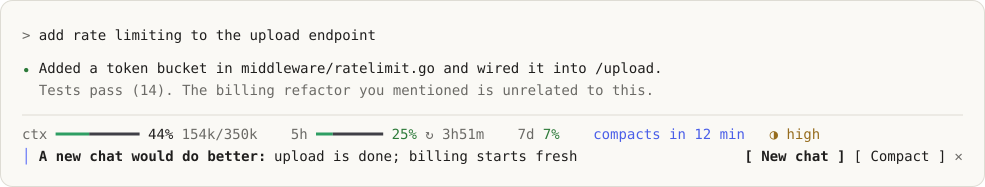
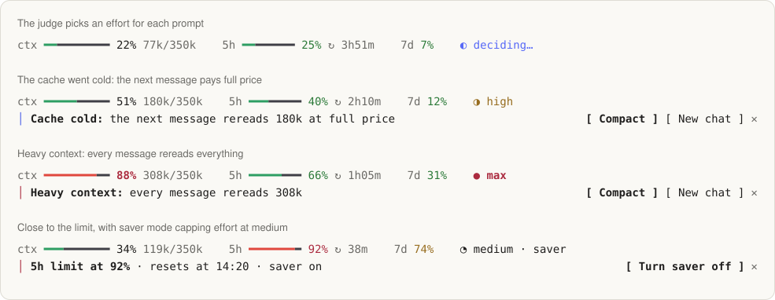
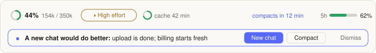

# Cadence

**Spend tokens where they matter.** Cadence is a Claude Code plugin that picks the effort for every prompt, shows your context in tokens, and tells you when to compact or start fresh, before the next message costs more than it should.

<picture>
  <source media="(prefers-color-scheme: dark)" srcset="assets/band-dark.svg">
  
</picture>

```
/plugin marketplace add Kelvin-Jesus/cadence
/plugin install cadence@kj-mods
```

Run `/reload-plugins` in chats that are already open. That's it: the band shows up under the prompt and auto effort is on.

> [!NOTE]
> If [effortless](https://github.com/HeyCubit/effortless) is installed, disable it. Both pick the effort and compact, so they would fight.

### Or let Claude install it

Paste this into Claude Code:

```text
Install the cadence plugin for me:
1. Run `claude plugin marketplace add Kelvin-Jesus/cadence`, then `claude plugin install cadence@kj-mods`.
2. If the effortless plugin is installed, disable it. It also picks effort and compacts, so the two would conflict.
3. In ~/.claude/settings.json, set env.CLAUDE_CODE_AUTO_COMPACT_WINDOW to "350000" so autocompact matches cadence's budget. Keep every other setting as it is.
4. Tell me what you changed, and remind me to run /reload-plugins in chats that are already open.
```

## Where your tokens go

| The leak | What cadence does |
|---|---|
| "ok" and "go on" run at the same effort as a refactor | A fast judge picks **low → max** for each prompt, and follow-ups keep the current effort without a judge call |
| Subagents inherit the main chat's effort | Each subagent gets its own effort from its task, so a file search runs at low |
| After the prompt cache expires, the next message rereads everything at full price | A warning the moment it goes cold, with **Compact** ready |
| A long chat rereads 300k tokens on every message | A warning past 85% of your budget, with **Compact** and **New chat** one click away |
| The chat model writes the compaction summary | Haiku writes it, then a safety net adds edited files, open tasks and your last request |
| An idle chat stays heavy until you come back | It compacts on its own after 60 quiet minutes, with a countdown |

`/cadence savings` shows what it measured in your session, not an estimate:

```
Saved by cadence this session
Tokens: 180k freed by compaction (200k → 20k, 90% smaller).
Dollars: $0.45 saved on compaction (Haiku $0.05 vs ~$0.50 for the chat model, estimate, warm cache).
Effort: 3 of 4 prompts ran below high effort.
```

## Reading the band

Line one is plain text: thin bars, no badges. Each bar and its percent share a tone (green, amber, red), and everything else is muted. Line two shows only the most urgent warning, with the button that fixes it.

<picture>
  <source media="(prefers-color-scheme: dark)" srcset="assets/states-dark.svg">
  
</picture>

| Part | Meaning |
|---|---|
| `ctx ━━━━━━━━━━ 44% 154k/350k` | Context used against **your budget**, not the model window. Amber from 70%, red from 85% |
| `5h ━━━━━━━━ 25% ↻ 3h51m` | 5-hour limit and the time until it resets. Amber from 70%, red from 90% |
| `7d 7%` | 7-day limit, same tones |
| `compacts in 12 min` | Idle compaction countdown, shown while the chat sits idle |
| `◑ high` | The effort for this prompt. The glyph's shape gives the level too: `○` low · `◔` medium · `◑` high · `◕` very high · `●` max |

Any nonzero value shows at least one cell, so 1% never looks empty. On terminals under 100 columns the `/350k` and `7d` drop out, and under 80 the reset countdown goes too. With `TERM=dumb` the bars fall back to ASCII. The cache timer lives in `/cadence` and the desktop app.

### In the desktop app

The same band becomes a context ring, a cache arc and thin limit meters, each with alt text for screen readers.

<picture>
  <source media="(prefers-color-scheme: dark)" srcset="assets/desktop-dark.svg">
  
</picture>

## Commands

| Command | Does |
|---|---|
| `/cadence` | Shows what applies now: effort, context, cache, judge and compaction |
| `/cadence savings` | Tokens and dollars saved this session |
| `/cadence stats` | Session cost by effort, judge, compaction and subagent |
| `/cadence auto` | Turns auto effort on or off |
| `/cadence saver` | Caps effort at medium until the limit resets |
| `/cadence compact [note]` | Compacts now. The note tells the summary what to keep |
| `/cadence handoff [full] [continue\|wait\|copy]` | Writes a handoff and moves to a clean chat |
| `/cadence judge` | Tests each judge and shows its latency |
| `/cadence bench [pt] [haiku\|jev\|local]` | Scores a judge on the labeled cases |
| `/cadence help` | Lists the commands |

To force an effort for one prompt, ask by name ("use max effort") and the judge is skipped.

## Ways to use it

Set options with `/plugin configure cadence@kj-mods` or in `/config`.

**Spend as little as possible.** `maxEffort: high` · `bias: -1` · `heavyPct: 75` · `idleMinutes: 30`

**Never trade quality.** `minEffort: high` · `bias: 1`. You still get the band, the cold-cache warning and cheaper compaction.

**Stay on a Pro plan all day.** `contextBudget: 200000` · `handoffAdvice: on` · `afterHandoff: wait`. When a limit passes 80%, press **Turn saver on**.

**Keep the judge offline.** `judge: local`, with [Ollaya](https://github.com/ollaya-dev/ollaya) running (see [Choose your judge](#choose-your-judge)).

**Change the colors.** `theme: tokyonight`, `dracula`, `nord`, `gruvbox`, `catppuccin`, `solarized`, `github`, `oled`, or `ocean`, `sunset`, `mono`, `colorblind`. The classics keep each palette's hues, nudged only as far as needed to stay readable on light and dark. Percent text keeps following your Claude Code theme.

**Just the band.** `autoEffort: off` · `idleMinutes: 0` · `compactWith: session`. Cadence only shows and warns, and Claude Code does the rest.

For Claude Code's own autocompact to match the band, use the same budget in `~/.claude/settings.json`:

```json
{ "env": { "CLAUDE_CODE_AUTO_COMPACT_WINDOW": "350000" } }
```

<details>
<summary><b>All options</b></summary>

| Option | Default | Values | What it does |
|---|---|---|---|
| `language` | `en` | `en` · `pt-BR` | Language of the band, toasts and `/cadence` output. Commands and option values stay in English |
| `contextBudget` | `350000` | `200000` → `1000000` | The bar counts against this total, not the model window |
| `autoEffort` | `on` | `on` · `off` | `off` uses the app's effort |
| `judge` | `auto` | `auto` · `haiku` · `jev` · `local` | Who picks the effort. Haiku is always the fallback |
| `localUrl` | empty | URL | Local judge server. Empty means Ollaya at `http://127.0.0.1:11435` |
| `localModel` | empty | text | Local model. Empty means `laya:multilingual` (CPU). `winnow:e4b` for NVIDIA GPUs |
| `typesafeKey` | empty | secret | Key for Jev. Kept in secure storage, never `settings.json` |
| `minEffort` | `low` | `low` → `max` | Auto never picks below this |
| `maxEffort` | `max` | `low` → `max` | Auto never picks above this |
| `bias` | `0` | `-2` → `2` | Cheaper or more thorough. Only moves the calls where the judge was unsure |
| `theme` | `default` | `default` · `ocean` · `sunset` · `mono` · `colorblind` · `tokyonight` · `dracula` · `nord` · `gruvbox` · `catppuccin` · `solarized` · `github` · `oled` | Colors of the bars and desktop graphics. All pass 3:1 on light and dark. `colorblind` uses blue and orange |
| `compactWith` | `haiku` | `haiku` · `session` | Who writes the compaction summary |
| `idleMinutes` | `60` | `0` · `15` → `120` | Compact after this long idle. `0` turns it off |
| `idleMinTokens` | `30000` | `15000` → `100000` | Smaller chats are not compacted when idle |
| `heavyPct` | `85` | `60` → `90` | Share of the budget that triggers the heavy-context warning |
| `afterHandoff` | `continue` | `continue` · `wait` · `copy` | Keep going in the new chat, wait there, or copy the handoff and stay |
| `handoffAdvice` | `on` | `on` · `off` | From 30% of the budget, Haiku says when a new chat would do better |
| `handoffSkill` | empty | skill name | Writes the full handoff. Empty means cadence checks git and writes `HANDOFF.md` |

</details>

## Choose your judge

| Judge | Runs on | Needs |
|---|---|---|
| `haiku` | Haiku 5.5 through your session login | nothing |
| `jev` | TypeSafe's Jev in the cloud | a key in `typesafeKey`, `TYPESAFE_API_KEY` or `~/.config/jev/.env` |
| `local` | a decision model on your machine, offline | [Ollaya](https://github.com/ollaya-dev/ollaya) running |
| `auto` (default) | local if `localUrl` is set, then Jev if a key is found | nothing |

If a judge is down, slow (3 s for Jev, 8 s for local) or under 50% sure, Haiku decides that prompt.

To run fully offline:

```sh
ollaya pull laya:multilingual
ollaya serve
```

Then set `judge: local` and run `/cadence judge` to confirm it answers. Any server that speaks `/v1/systemone` works, and a `localUrl` ending in `/chat/completions` uses a regular chat model through the OpenAI API.

## How accurate is the judge?

`/cadence bench` runs 91 labeled messages through the real prompt path. Each answer counts as right if it is one of the efforts a careful person would accept. Haiku 5.5, run of 2026-11-12:

| Set | Cases | Correct | Median time |
|---|---|---|---|
| All | 91 | 96% | 2.0 s |
| effortless holdout | 20 | 95% | 2.0 s |
| Portuguese | 16 | 94% | 2.1 s |

The set is small and the judge is not deterministic, so runs move by a few points. Results go to `cadence/bench/resultados/`. Jev and local judges aren't benchmarked yet.

## Design

- **Follows your theme.** Text uses Claude Code's theme keys. Bar and desktop graphic tones pass 3:1 on light and dark, checked by a test.
- **Never color alone.** Every level also has a number, a word or a glyph shape.
- **Calm.** Nothing blinks or loops, and the warning buttons step aside while the agent works.

## Develop

```
claude plugin validate cadence
claude plugin test cadence
```

The README images are drawn from the band's own colors by `python3 assets/make.py`.

## Credits

Cadence merges the earlier `contexto-pct` with the best parts of [effortless](https://github.com/HeyCubit/effortless) (MIT, notice in `cadence/THIRD_PARTY_LICENSE-effortless.txt`). Released under the MIT license.
